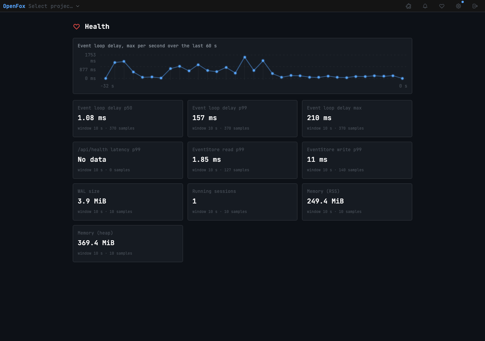
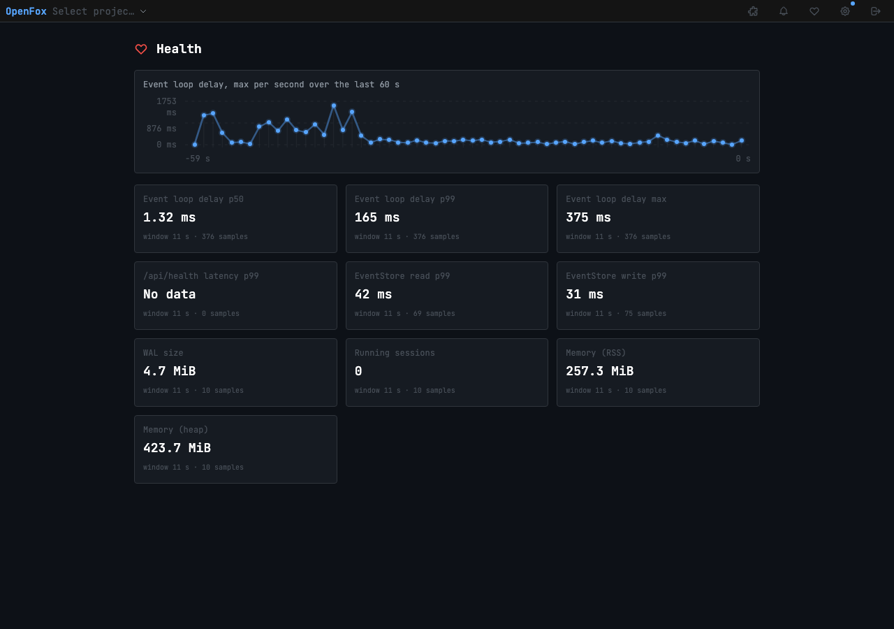

# Démo étape 1 — Tableau de bord de santé

Branche `mt/etape1-sante` (depuis `main` 6cd750e5). Mesures faites le 2026-10-21 sur le Mac mini, alors chargé par
d'autres sessions (charge moyenne 25 à 35 pour 14 cœurs) : les chiffres sont bruités. La même démo tourne dans la
porte de pré-commit, dans Docker sur la .122.

## Ce qui est livré

- `GET /api/diagnostics` (authentifié comme le reste de `/api`, contrairement à `/api/health`). Un collecteur unique
  range les observations par intervalles fixes d'1 s, garde 60 s d'historique (60 intervalles au plus) et calcule les
  statistiques sur les 10 dernières secondes en additionnant des histogrammes fusionnables. Un intervalle expire selon
  son horodatage, même si aucun tick n'a tourné pendant un blocage. Les lecteurs ne modifient jamais l'état.
- Séries : retard de la boucle p50, p99, max ; latence de `/api/health` (p99, temps de traitement côté serveur) ;
  lecture et écriture de l'EventStore (p99) ; taille du WAL ; sessions en cours ; RSS ; heap. Chaque série porte son
  unité, sa fenêtre et son nombre d'échantillons, et vaut `null` sans données.
- Page `/sante` (icône cœur dans l'en-tête) : lecture toutes les 2 s via `diagnosticsResource`, courbe du retard max
  par seconde sur 60 s, erreur et données périmées signalées, arrêt du polling au démontage.

## Méthode de mesure (référence pour les étapes suivantes)

- **Retard de la boucle** : un minuteur `setTimeout` de 20 ms note de combien il se réveille en retard (heure réelle
  moins heure prévue). Ce n'est pas `monitorEventLoopDelay`. La résolution est d'environ 20 ms, et un blocage de B ms
  donne un échantillon d'environ B ms. Les démos suivantes doivent comparer ces mêmes séries.
- Ces chiffres ne sont pas comparables aux « 22 ms » de Perf Streaming : ceux-là sont le p99 de
  `GET /api/sessions/:id` mesuré par le banc, sur la .122 sous Docker, pas un retard de boucle.
- **`/api/health`** : la page affiche le temps de traitement côté serveur (de l'entrée dans la route à la fin de la
  réponse). L'attente avant d'entrer dans la route, pendant un blocage, n'y figure pas ; seul le sondeur externe de la
  démo la voit. La série vaut « pas de données » quand personne n'a appelé `/api/health` dans la fenêtre.
- **Surcoût** : `bench:diagnostics-overhead` mesure le collecteur seul dans un processus inactif, et non un serveur
  complet. Avec `dbPath` à `:memory:`, le `stat()` du WAL fait chaque seconde n'est pas compté.

## Vérifications

| Commande                                                                         | Résultat                                        |
| -------------------------------------------------------------------------------- | ----------------------------------------------- |
| `npx vitest run src/server/diagnostics`                                          | 17 tests verts                                  |
| `npx vitest run web/src/components/health`                                       | 4 tests verts                                   |
| `npm run bench:diagnostics-overhead`                                             | surcoût 0,51 % d'un cœur (0,60 % contre 0,09 %) |
| `npx vitest run --config e2e/vitest.config.ts e2e/health-dashboard.demo.test.ts` | 3 tests verts                                   |
| `npx vitest run --config e2e/vitest.config.ts e2e/load-run.test.ts`              | 3 tests verts (nettoyage en cas d'échec)        |

Le banc et ses sondes passent par `e2e/utils/load-run.ts`. Quel que soit le chemin d'échec (sortie non nulle, timeout,
assertion ratée pendant le banc), les sondes s'arrêtent, tout le groupe de processus du banc (serveur LLM compris) est
tué, et le minuteur est annulé. `e2e/load-run.test.ts` force chacun de ces cas avec un faux banc qui lance un
petit-enfant, et vérifie qu'il ne reste ni processus ni minuteur.

`HEALTH_DEMO_REPORT=<fichier>` conserve les chiffres de la démo ; ceux ci-dessous viennent de
[`etape1-report.json`](etape1-report.json).

## Instance isolée

HOME, XDG, `OPENFOX_DB_PATH` et la configuration pointent vers un dossier temporaire, posés avant le démarrage du
processus enfant. L'enfant refuse de démarrer si l'un d'eux sort de `tmpdir()`. Port 10600. `lsof` sur le serveur, le
processus de test et le banc : la base ouverte est `/private/tmp/openfox-health-demo-…/sessions.db`, et aucun fichier
sous `~/Library/Application Support/openfox*` n'est ouvert.

## a) Preuve du capteur : blocage calibré de 500 ms

Route `POST /api/test/block-loop`, présente seulement en mode test avec `OPENFOX_TEST_BLOCK_LOOP=1`.

| Moment                  | Retard p99 | Retard max |
| ----------------------- | ---------- | ---------- |
| Avant                   | 63,7 ms    | 63,7 ms    |
| Juste après le blocage  | 709,2 ms   | 709,2 ms   |
| 11,7 s après le blocage | 87,3 ms    | 120,4 ms   |

Le max détecte le blocage (au moins 80 % des 500 ms injectées) et retombe une fois l'intervalle sorti de la fenêtre de
10 s.

## b) Banc de streaming contre la même instance

`scripts/bench/stream-batching.ts --server-url=<instance>` : 40 appels LLM, 40 000 fragments à 3 000 par seconde. Tour
de 18,3 s, sans timeout. Un sondeur externe interroge `/api/health` toutes les 100 ms, avec un timeout de 2 s.

| Mesure                                    | Valeur                                     |
| ----------------------------------------- | ------------------------------------------ |
| Requêtes `/api/health`                    | 345                                        |
| Timeouts / erreurs                        | 0 / 0                                      |
| Latence externe p50 / p99 / max           | 1,6 / 69,6 / 457 ms                        |
| Retard de la boucle pendant le banc (pic) | p99 87,3 ms, max 588 ms                    |
| Sessions en cours                         | 0, puis 1 pendant le tour, puis 0 au repos |
| WAL                                       | de 8 Kio à environ 4 Mio                   |

## Captures de `/sante`

Instance isolée en mode développement (Vite dans le même processus), port 10610, banc de 60 appels et 60 000
fragments. Le retard monte au démarrage du banc, quand Vite compile aussi les modules de la page dans le processus
serveur (jusqu'à 1,75 s), puis redescend sous 100 ms. Aucun fichier de production ouvert (`lsof`). Depuis ces
captures, la carte « /api/health latency p99 » s'appelle « /api/health server handling p99 » (« Traitement serveur
/api/health p99 » en français).

Pendant le banc (une session en cours) :

Après le banc (aucune session en cours, retard revenu au repos) :

